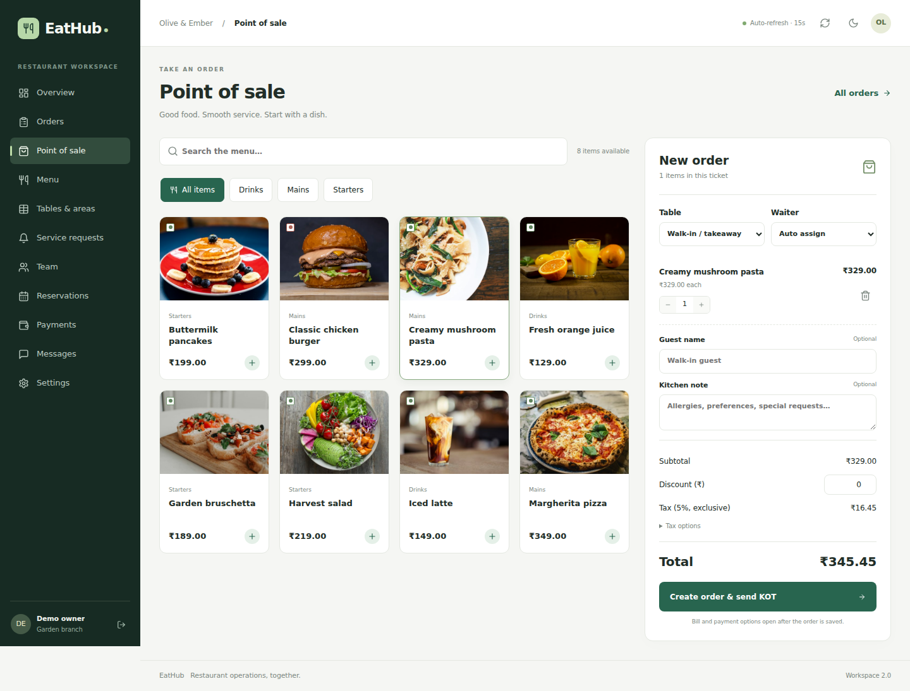

# EatHub — restaurant workspaces

React frontend for the EatHub/AK47 restaurant platform. Version 2.0 replaces state-switched dashboard sections with bookmarkable URLs and a consistent, responsive workspace for restaurant admins, waiters, kitchen staff, diners and platform admins.

## Run the matching app

Use the [AK47 parent repository](https://github.com/mohanreddytm/AK47), which pins compatible frontend and backend commits. Initialize both submodules, run `npm run setup`, then use `npm run demo` for a local preview or configure your existing database and run `npm run db:migrate` followed by `npm run dev`. See the parent README and backend OPERATIONS.md for exact instructions.

Standalone frontend: `npm ci`, copy `.env.example` to `.env`, set `REACT_APP_API_BASE_URL=http://localhost:8000`, and run `npm start`. Start the matching backend separately. Restart React whenever an environment value changes. Never put database credentials, JWT secrets or Razorpay secrets in a `REACT_APP_` variable.

## Routes

| Workspace | Paths |
|---|---|
| Restaurant admin | `/restaurantDashboard/overview`, `/orders`, `/pos`, `/menu`, `/tables`, `/requests`, `/staff`, `/reservations`, `/payments`, `/messages`, `/settings`, `/setup` under the same dashboard prefix |
| Existing order | `/restaurantDashboard/pos/:orderId` |
| Waiter | `/waiterDashboard/overview`, `/orders`, `/pos`, `/pos/:orderId`, `/tables`, `/requests`, `/payments`, `/messages` under the waiter prefix |
| Kitchen | `/kotDashboard/kitchen`, `/kotDashboard/overview` |
| Guest entrance | `/tables/:restaurantId` |
| Table menu | `/customerDashboard/:tableId/:restaurantId/home` |
| Guest cart and history | `/customerDashboard/:tableId/:restaurantId/cart`, `/orders`, `/orders/:orderId`, `/favourites`, `/profile` under the same table prefix |
| Platform administration | `/superAdminDashboard/restaurants` and `/superAdminDashboard/restaurants/:id` |

An order link contains the persisted order UUID; no route state or in-memory selection is needed to load its bill. Sections survive refresh, direct links and browser navigation. The old bare dashboard URLs redirect to their overview/kitchen screen.

## User flows

- POS keeps drafts per staff member and order in the current tab. Failed saves show inline errors and preserve the cart. New-order retries reuse a request ID to prevent duplicate tickets. The server owns menu prices and totals.
- Existing-order POS includes extra KOT, discount/tax, bill, print, verified counter payment, cancellation and waiter assignment. Payment and kitchen progress remain separate for prepaid orders.
- Orders, service requests, kitchen tickets and assigned waiter work refresh every 15 seconds while the workspace is visible. Chat refreshes every 10 seconds.
- Menu categories/items, table areas, staff accounts, reservation windows and restaurant/payment settings use API-backed forms with inline validation. Destructive actions require a clear confirmation.
- QR guests get a table-scoped session, cart, favourites, profile, own-order tracking and service/payment requests. A new or expired session does not disclose another diner's order history.
- Optional Razorpay **test** checkout appears only for a backend-configured restaurant. A button click or client callback alone cannot mark a payment successful.
- Responsive navigation, table scrolling, keyboard focus and native dialogs support desktop and mobile. Light/dark preference is saved locally.

## Validation

`npm run build` creates the production bundle. `CI=true npm test -- --watchAll=false --runInBand` runs URL/authorization and order-action regressions. On Windows, run `npm test -- --watchAll=false --runInBand` directly.

After building, run `npx playwright install chromium` and `npm run test:e2e`. The smoke script starts its own disposable backend and static frontend on ports 8000 and 3000, exercises admin POS, kitchen, waiter, guest and platform flows, and writes screenshots in `docs/previews`. Keep those ports free. It finds the backend through the AK47 checkout or an adjacent `backend` folder; `EATHUB_BACKEND_DIR` can override that location. `EATHUB_BROWSER_PATH` optionally supplies an installed Chromium executable.

Automated tests use fictional data and do not prove compatibility with your live Neon history, printer or merchant account. Test those in your deployment before serving real diners.

## Hosting

Build with `REACT_APP_API_BASE_URL=https://<your-backend-host>`. Vercel routing is configured in `vercel.json`; `public/_redirects` supports hosts that use that format. For other static hosts, serve `index.html` for non-file routes so `/restaurantDashboard/pos/:orderId` works on refresh. Add the deployed frontend origin to backend `CORS_ORIGINS`. Deploy the matching backend and apply its database migration first.
